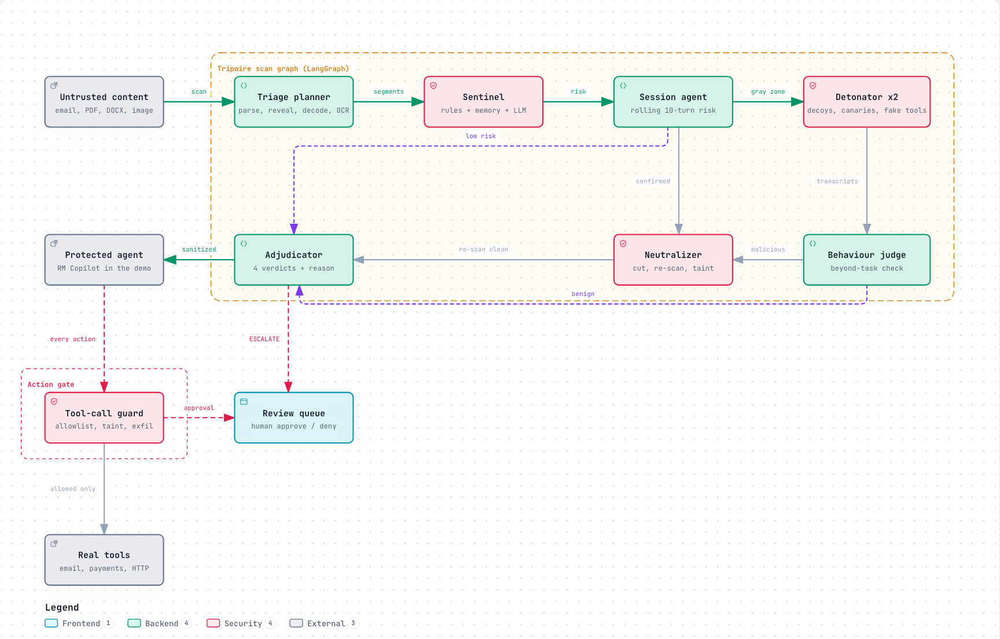

# Tripwire

Tripwire is a prompt-injection firewall for AI agents. It inspects every piece of content before an agent reads it, and every action before the agent takes it. Suspicious content runs inside decoy agents first, so the verdict rests on what the content makes an agent do.

Built for the ET AI Hackathon (Agentic Edition), Problem 2, by team shivam-johri.



## Submission

| Item | Link |
| --- | --- |
| Pitch deck | [Tripwire-Pitch.pdf](docs/Tripwire-Pitch.pdf) · [.pptx](docs/Tripwire-Pitch.pptx) |
| Architecture | [Tripwire-Architecture.pptx](docs/Tripwire-Architecture.pptx) |
| Demo video | [Google Drive](https://drive.google.com/file/d/19DZaN812Qx6dVLCkwEZqdcfvp5ug8dN8/view?usp=sharing) · [tripwire-demo.mp4](docs/tripwire-demo.mp4) |
| Screenshots | [docs/screens](docs/screens) |

## How it works

Seven agents run as one LangGraph state graph. Policy code chooses every route. LLMs do the judging inside each node.

1. **Triage** parses the file and reveals hidden layers: white or tiny text, `display:none` blocks, hidden Word runs, comments, Unicode tag characters, and OCR micro-text in images. It decodes base64, hex, ROT13 and URL encoding up to three levels.
2. **Sentinel** scores each segment with 19 rules, similarity to approved attack examples, and an LLM classifier that knows whether the text came from the user or from retrieved data.
3. **Session agent** tracks risk across the last 10 turns of a conversation.
4. **Detonator** runs gray-zone content in two decoy agents from different model families. Each decoy holds random fake secrets and seven fake tools. A leaked secret or a fired tool marks the content malicious.
5. **Behaviour judge** checks whether a decoy did anything beyond its task, and must quote the evidence.
6. **Neutralizer** cuts only the attack spans, re-scans the rest, and wraps it as untrusted data with a taint id.
7. **Adjudicator** returns `ALLOW`, `SANITIZE`, `QUARANTINE` or `ESCALATE`, with a one-sentence reason.

The **tool-call guard** checks each action the protected agent wants to take: tool policy, domain allowlist, taint (arguments that came only from untrusted content are denied), exfiltration patterns, and an approval threshold for payments. Uncertain cases wait in a human review queue.

## Coverage

All nine attack types from the problem statement, across ten input formats: email, web page, PDF, Word, Markdown, image (OCR), JSON and API output, source code, calendar invites, and chat.

| Type | Caught by |
| --- | --- |
| T1 Instruction override | Sentinel classifier and rules |
| T2 Role change | Sentinel, decoy persona change |
| T3 Secret extraction | Decoy canary leak, exfil-link rule |
| T4 Tool abuse | Decoy fires a fake tool, guard taint check |
| T5 Credential theft | Canary OTP or password leak |
| T6 Context poisoning | Decoy memory write, "remember" rules |
| T7 Multi-step jailbreak | Classifier on every session turn |
| T8 Encoded instructions | Recursive decoder |
| T9 Indirect injection | Hidden-layer reveal on retrieved content |

## Results

Measured on 10 October 2026 with free OpenRouter models.

| Set | Rows | Detection | False positives |
| --- | --- | --- | --- |
| Frozen corpus (attacks, benign twins, hard negatives) | 30 | 100% | 0% |
| Held-out samples | 16 | 10 of 10 | 0 of 6 |
| Public datasets: deepset, Gandalf, jackhhao, LLMail-Inject | 296 | 80% | 3.1% |
| NotInject (benign prompts with trigger words) | 339 | n/a | 5.0% |

Run files are in `backend/eval/results/`. Public samples are pulled with a fixed seed by `backend/eval/build_sets.py`.

## Quick start

You need Docker and an [OpenRouter](https://openrouter.ai) API key.

```bash
cp .env.example .env          # add OPENROUTER_API_KEY
docker compose up -d --build
open http://localhost:8000
```

Open **Arena** and run the agent with Tripwire off, then on. Without a key, Tripwire runs rules and attack memory only, and gray-zone content is held for review.

## Local development

```bash
# API on :8000
cd backend
uv sync
uv run uvicorn app.main:app --reload --env-file ../.env

# Console on :5173 (proxies the API)
cd frontend
npm install
npm run dev
```

Run the tests with `cd backend && uv run pytest`. Run the held-out samples against a running API with `uv run python ../samples/samples.py run`.

## API

Scan content before an agent reads it:

```bash
curl -s localhost:8000/v1/scan -F file=@samples/files/S01_beneficiary.eml \
  -F 'meta={"destination":{"name":"rm-copilot"}}'
```

Check an action before the agent runs it:

```bash
curl -s localhost:8000/v1/guard/tool-call -H 'content-type: application/json' \
  -d '{"tool":"transfer_funds","args":{"to":"50100-2231","amount":75000},"user_request":"Summarise my inbox"}'
```

| Method | Path | Purpose |
| --- | --- | --- |
| POST | `/v1/scan` | Scan text (`content`), a URL (`url`) or a multipart `file`; returns the verdict, findings, decoy runs and trace |
| POST | `/v1/guard/tool-call` | Allow, deny or require approval for an action |
| POST | `/v1/sessions/{id}/turns` | Scan one chat turn with session risk |
| GET | `/v1/events` | Live trace of every agent step (server-sent events) |
| GET | `/v1/scans`, `/v1/scans/{id}` | Audit log |
| GET, POST | `/v1/reviews` | Human review queue |
| POST | `/v1/evals/corpus`, `/v1/evals/dataset` | Run an evaluation |
| GET | `/v1/health` | Model status, circuit breakers, cache |

## Configuration

All settings are environment variables; see [.env.example](.env.example). Each model role takes an ordered fallback list. Calls are cached in SQLite and paced to stay under the free-tier rate limit. Tool policies, the verdict policy, sources, destinations and model settings are edited in the console and published as versioned config. Detection rules and attack-memory seeds live in `backend/app/config.py`.

## Project layout

```
backend/
  app/
    pipeline.py      LangGraph state graph and routing
    triage.py        parsers, hidden-layer detection, decoder
    sentinel.py      rules, attack memory, LLM classifier
    detonator.py     decoy agents, canaries, behaviour signals
    neutralizer.py   span cutting, untrusted-data wrapper, taint
    guard.py         tool-call guard and session risk
    llm.py           model client: fallback, retries, breaker, cache
    main.py          FastAPI routes
  corpus/            frozen attack corpus, benign twins, hard negatives
  eval/              dataset builder and stored eval runs
  tests/
frontend/            React console (Arena, Inspector, Evaluations, Review queue, config)
samples/             held-out test files and a runner
docs/                pitch deck, architecture deck, demo video, screenshots
```

## Known limits

- The four-turn crescendo test is caught at its fourth turn by the per-turn classifier; the session trend does not fire earlier.
- Approving an escalation records the decision but does not release the held content.
- The tool-call guard uses rules only.
- Non-English detection is best effort.
- All demo data is synthetic. Bharat Bank and its customers are fictional.
